  

<h2 align="left">🧭 About Me</h2>

  

---

### ⚡ Tech Stack & Skills

#### 🎮 Game Development & Engine

  
  
  
  
  

#### 💻 Full-Stack & Web Development

  
  
  
  
  
  
  
  
  
  

#### 🛠️ Core Languages & Tools

  
  
  
  
  
  
  
  
  
  

---

### 📊 GitHub Activity & Stats

  

    
  

  

    
  

  

    
  

---

### 📡 Connect With Me

  
  
  
  

 

